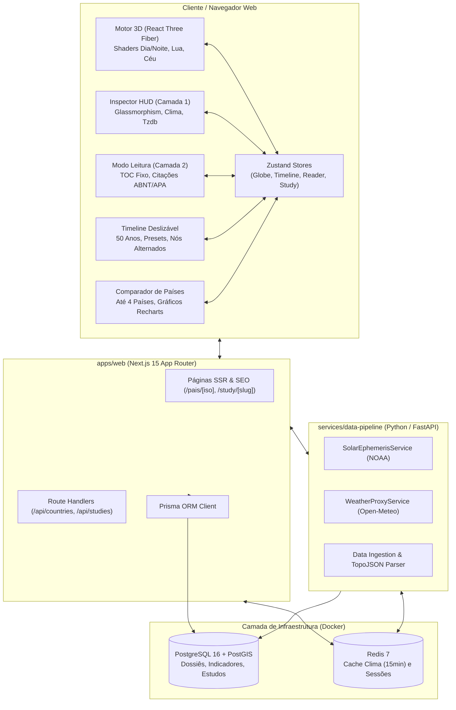
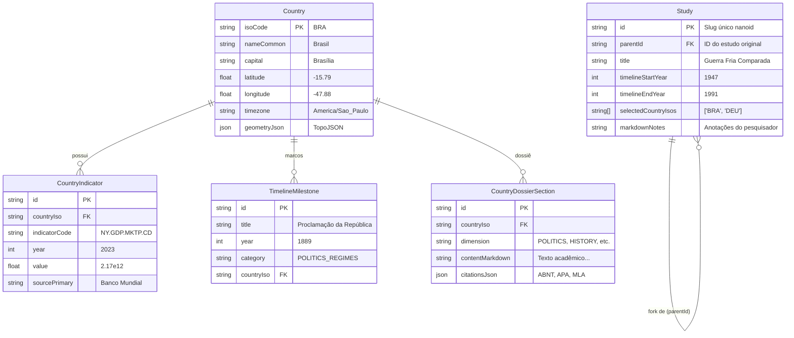

# Arquitetura Técnica — TellusPedia

## 1. Visão Geral da Arquitetura

O **TellusPedia** é concebido sob uma arquitetura de monorepo moderno que equilibra:
- Renderização gráfica 3D pesada em tempo real (WebGL/Three.js a 60 FPS) via **React Three Fiber**.
- Plataforma enciclopédica densa em **Next.js 15 (App Router)** com SSR, rotas semânticas indexáveis para SEO e leitura tipograficamente acadêmica.
- Microsserviço científico em **Python (FastAPI)** com Clean Architecture para efemérides solares NOAA, fases lunares e ingestão de datasets geofísicos.
- Persistência geoespacial com **PostgreSQL 16 + PostGIS**, cache segregado por volatilidade no **Redis 7** e ORM com **Prisma**.



---

## 2. Arquitetura do Frontend (`apps/web`)

### 2.1. Estrutura de Diretórios (Feature-Driven / Layered)
```
apps/web/
├── prisma/
│   ├── schema.prisma                  # Esquema Prisma (Country, Indicator, Milestone, Study)
│   └── seed.ts                        # Seed de países piloto, TopoJSON e marcos históricos
├── src/
│   ├── app/                           # App Router (Páginas, SEO e Route Handlers)
│   │   ├── layout.tsx                 # Root layout com tipografia Cosmic Academic
│   │   ├── page.tsx                   # Landing Page (Globo + HUD + Timeline)
│   │   ├── compare/page.tsx           # Comparador de até 4 países (/compare)
│   │   ├── pais/[iso]/page.tsx        # Página canônica do país para SEO (/pais/BRA)
│   │   ├── study/[slug]/page.tsx      # Estudo imutável compartilhado (/study/[slug])
│   │   └── api/                       # Endpoints Next.js com fallback local
│   ├── components/
│   │   ├── globe/                     # Motor 3D Three.js / React Three Fiber
│   │   │   ├── GlobeCanvas.tsx        # Canvas, iluminação solar sincronizada e render loop
│   │   │   ├── EarthSphere.tsx        # Esfera da Terra com shader dia/noite e Fresnel
│   │   │   ├── EarthShaderMaterial.ts # Shader GLSL em espaço mundial
│   │   │   ├── CountryBorders.tsx     # Malha vetorial esférica (Natural Earth TopoJSON)
│   │   │   ├── OrbitingMoon.tsx       # Lua em órbita com fase proporcional
│   │   │   ├── SkyStars.tsx           # Abóbada celeste com estrelas e constelações IAU
│   │   │   └── CameraFlyToController.tsx # Animação de câmera suave com interpolação esférica
│   │   ├── hud/                       # Camada 1: Inspector HUD
│   │   │   ├── InspectorHUD.tsx       # Drawer lateral flutuante em glassmorphism
│   │   │   ├── CountryHeader.tsx      # Bandeira vetorial, nome oficial e capital
│   │   │   ├── LiveWeatherWidget.tsx  # Clima ao vivo via Open-Meteo
│   │   │   ├── LocalClockWidget.tsx   # Relógio no fuso horário local tzdb
│   │   │   └── CountryMetricsGrid.tsx # Indicadores socioeconômicos rápidos
│   │   ├── reader/                    # Camada 2: Modo Leitura Profunda
│   │   │   ├── ReaderMode.tsx         # Layout imersivo de estudo acadêmico
│   │   │   ├── ReaderTableOfContents.tsx # Sumário fixo navegável (TOC)
│   │   │   ├── ReaderContent.tsx      # Renderização de texto com notas de rodapé
│   │   │   ├── HoverCardPreview.tsx   # Card flutuante para links internos
│   │   │   └── CitationModal.tsx      # Exportador ABNT NBR 6023, APA, MLA, BibTeX
│   │   ├── timeline/                  # Linha do Tempo Dinâmica
│   │   │   ├── TimelineBar.tsx        # Barra horizontal deslizável
│   │   │   ├── TimelineAxis.tsx       # Réguas de tempo e escala semântica
│   │   │   ├── MilestonePin.tsx       # Nós alternados acima/abaixo do eixo
│   │   │   ├── CategoryFilterPills.tsx# Filtros por categoria temática
│   │   │   └── PresetSelector.tsx     # Atalhos (Últimos 50 Anos, Guerra Fria, etc.)
│   │   ├── comparator/                # Comparador de até 4 Países (RN15)
│   │   │   ├── CountryComparator.tsx  # Painel comparativo
│   │   │   ├── ComparisonGrid.tsx     # Colunas métricas equiparadas
│   │   │   └── ComparisonCharts.tsx   # Gráficos de séries temporais com Recharts
│   │   ├── study/                     # Estudos Compartilháveis & Fork (RN16)
│   │   │   ├── StudyShareModal.tsx    # Modal de criação de link imutável
│   │   │   └── ForkStudyBanner.tsx    # Banner de estudo com botão "Fazer Fork"
│   │   └── nav/                       # Barra de navegação superior
│   ├── stores/                        # Gerenciamento de Estado Reativo (Zustand)
│   │   ├── globeStore.ts              # Hover, seleção, câmera e render loop throttling
│   │   ├── timelineStore.ts           # Anos, marcos, filtros de categoria e presets
│   │   ├── readerStore.ts             # Dimensão ativa e estado de leitura
│   │   ├── comparatorStore.ts         # Países selecionados para comparação
│   │   └── studyStore.ts              # Recorte de estudo e anotações Markdown
│   └── lib/                           # Utilitários, efemérides e formatadores
└── test/
    └── unit.test.ts                   # 19 testes automatizados cobrindo todas as regras
```

### 2.2. Engenharia Gráfica 3D (Shaders e Picking)

#### Shader de Terminador Solar Dia/Noite (`EarthShaderMaterial.ts`)
- O vertex shader calcula a normal em espaço mundial:
  ```glsl
  vNormal = normalize((modelMatrix * vec4(normal, 0.0)).xyz);
  ```
- O fragment shader calcula a incidência da luz solar através do produto escalar com o vetor de luz mundial:
  ```glsl
  float sunDot = dot(normal, uSunDirection);
  float dayFactor = smoothstep(-0.15, 0.25, sunDot);
  vec3 finalColor = mix(nightColor, dayColor, dayFactor);
  ```
- O brilho atmosférico translúcido é gerado via efeito Fresnel:
  ```glsl
  float fresnel = pow(1.0 - max(dot(normal, viewDir), 0.0), 3.0);
  finalColor += uAtmosphereColor * fresnel * 0.6;
  ```

#### Picking Ultrarrápido por Raycast Lat/Long (<0.2ms)
1. O raycaster atinge uma esfera física única de raio unitário ($R=1.0$).
2. A intersecção $(x, y, z)$ é convertida matematicamente em coordenadas geográficas:
   $$\text{lat} = \arcsin(y / R) \cdot \frac{180}{\pi}, \quad \text{lng} = \arctan2(-z, x) \cdot \frac{180}{\pi}$$
3. O ponto $(\text{lng}, \text{lat})$ é consultado em memória no índice espacial montado com `which-polygon` a partir do TopoJSON Natural Earth. O tempo de resposta é inferior a 0.2 milissegundos sem sobrecarregar a GPU com malhas 3D individuais.

#### Render Loop Throttling (RN22)
Quando o usuário expande a Camada 2 (Modo Leitura Profunda), o estado `isReaderOpen` aciona a desaceleração do loop gráfico do Three.js, reduzindo o consumo de energia e ciclos de GPU durante o estudo textual prolongado.

---

## 3. Arquitetura do Backend (`services/data-pipeline`)

O microsserviço Python em **FastAPI** segue a **Clean Architecture**, segregado em:
1. **Controladores (`app/api/endpoints`)**:
   - `astronomy.py`: Retorna a declinação solar, longitude subsolar e fases da Lua calculadas pelo algoritmo NOAA.
   - `weather.py`: Proxy resiliente para a Open-Meteo API com cache Redis.
2. **Camada de Domínio (`app/domain/models`)**: Modelos Pydantic tipados e imutáveis.
3. **Serviços Científicos (`app/services`)**:
   - `solar_service.py`: Cálculo da posição solar a partir da data e hora UTC.
   - `weather_proxy_service.py`: Cache e circuit breaker para chamadas externas.
4. **Infraestrutura (`app/core`)**: Pool de conexões assíncronas do Redis e PostgreSQL.

---

## 4. Política de Segregação de Cache (RN23)

| Camada de Dados | Fontes | Armazenamento | Política de Cache / TTL |
| :--- | :--- | :--- | :--- |
| **Alta Volatilidade** | Clima (Open-Meteo), efemérides solares em tempo real. | Redis 7 | **15 minutos** com renovação automática. |
| **Média Volatilidade** | Indicadores socioeconômicos anuais (Banco Mundial, IBGE), notícias GDELT. | PostgreSQL + Redis | **24 horas a 7 dias**; atualizados por jobs em lote. |
| **Imutável** | Polígonos de fronteiras (TopoJSON), marcos históricos consolidados, estudos compartilhados. | PostgreSQL 16 (PostGIS) | **Permanente**. Headers `Cache-Control: public, max-age=31536000, immutable`. |

---

## 5. Modelo de Dados e Estudos Imutáveis com Fork (RN16)


