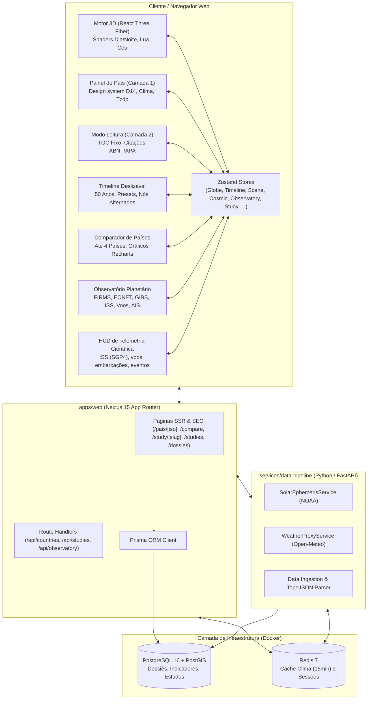
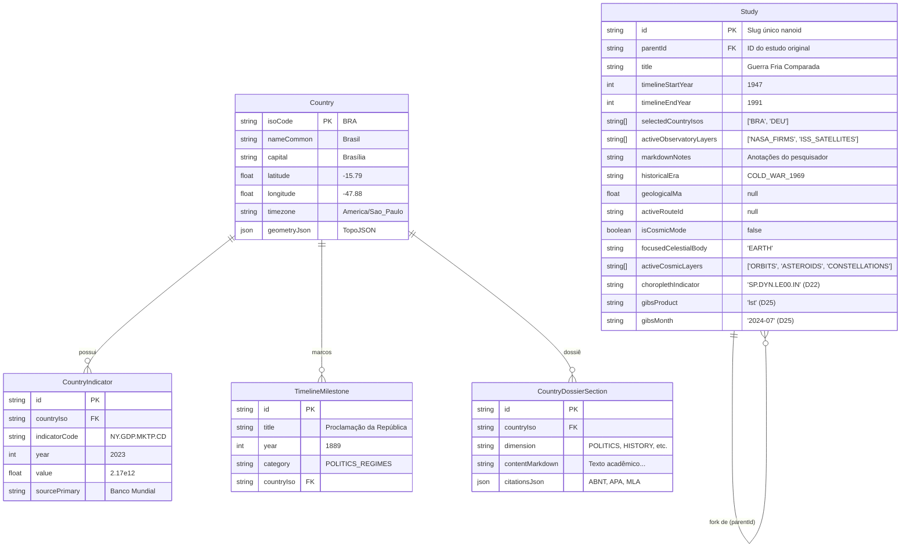

# Arquitetura Técnica — TellusPedia

## 1. Visão Geral da Arquitetura

O **TellusPedia** é concebido sob uma arquitetura de monorepo moderno que equilibra:
- Renderização gráfica 3D pesada em tempo real (WebGL/Three.js a 60 FPS) via **React Three Fiber**.
- Plataforma enciclopédica densa em **Next.js 15 (App Router)** com SSR, rotas semânticas indexáveis para SEO e leitura tipograficamente acadêmica.
- Microsserviço científico em **Python (FastAPI)** com Clean Architecture para efemérides solares NOAA, fases lunares e ingestão de datasets geofísicos.
- Persistência geoespacial com **PostgreSQL 16 + PostGIS**, cache segregado por volatilidade no **Redis 7** e ORM com **Prisma**.



---

## 2. Arquitetura do Frontend (`apps/web`)

### 2.1. Estrutura de Diretórios (Feature-Driven / Layered)

Resumo dos diretórios e dos módulos centrais (2026-11-21). Arquivos grandes de dados foram divididos em módulos coesos na T36; os módulos antigos (`country-data`, `historical-entities`, `astronomy-planets`, `paleo-data`) continuam re-exportando tudo.

```
apps/web/
├── public/
│   ├── data/
│   │   ├── countries-ne-110m.json          # Catálogo dos 177 países (Natural Earth 1:110m)
│   │   ├── countries-worldbank-indicators.json # Indicadores do Banco Mundial (T26)
│   │   ├── worldbank-timeseries.json       # Séries 1990–2024 (T32), carregadas sob demanda
│   │   ├── history/                        # TopoJSON de 1870, 1914, 1939 e 1969
│   │   ├── paleo/                          # Paleomapas PALEOMAP
│   │   └── sky/                            # HYG v4.1 (binário) e Via Láctea
│   ├── observatory/gibs/                   # Referências locais e legendas do NASA GIBS (D25)
│   ├── flags/                              # Bandeiras históricas em SVG
│   ├── models/                             # Modelos glTF (aeronaves, embarcações)
│   ├── basis/                              # Transcoder e worker do KTX2 (T30)
│   └── textures/                           # Terra, planetas e Lua (KTX2 + JPG/PNG)
├── prisma/                                 # schema.prisma, migrations versionadas e seed
├── scripts/                                # Ingestão (Banco Mundial, Wikidata), índice de cenas,
│                                           # tabela do cn (build-tw-merge-table), texturas, testes
├── src/
│   ├── app/                                # App Router: /, /pais/[iso], /compare, /study/[slug],
│   │   │                                   # /studies, /dossies, /telluslab, sitemap, robots, manifest
│   │   └── api/                            # astronomy, countries, health, observatory/*, studies, timeline, weather
│   │       └── observatory/                # ais, cosmos, eonet, firms, gibs (+ /image), iss, satellites, traffic
│   ├── components/
│   │   ├── globe/        # Canvas R3F: EarthSphere/EarthShaderMaterial, CountryBorders, OrbitingMoon,
│   │   │                 # SkyStars, SunCore, PlanetarySystem/PlanetBody, CometHalleyTrajectory (+ shaders
│   │   │                 # e geometria), camadas do Observatório (FIRMS, EONET, GIBS, ISS, voos, AIS),
│   │   │                 # PaleoPlatesLayer, ChoroplethOverlay, câmeras e badges de era
│   │   ├── scenes/       # Player genérico: ScenePlayer, ScenePlayerOverlay, trajetórias de superfície e cislunar
│   │   ├── shell/        # GlobeExperienceShell (carrega painéis e overlays sob demanda)
│   │   ├── layout/       # RightDock e gerenciamento de painéis (D15)
│   │   ├── nav/          # TopNavBar
│   │   ├── timeline/     # TimelineBar, TimelineAxis, MilestonePin/Cluster, PresetSelector
│   │   ├── hud/          # InspectorHUD (país), CosmicInspectorHUD, clima e relógio locais
│   │   ├── reader/       # Modo Leitura, sumário, conteúdo, hover preview, CitationModal
│   │   ├── comparator/   # CountryComparator, grade e gráficos (Recharts, sob demanda)
│   │   ├── choropleth/   # HUD do mapa temático (D22)
│   │   ├── observatory/  # ObservatoryPanel, controles por camada, HUD de telemetria
│   │   ├── study/        # StudyShareModal, ForkStudyBanner
│   │   ├── explore/      # Busca ⌘K e sincronização com a URL (D18)
│   │   ├── tellus-bridge/# Ponte com o TellusLab (contexto de estudo, lançadores)
│   │   └── ui/           # Primitivos do design system D14 e cn()
│   ├── stores/           # Zustand: globe, timeline, scene, cosmic, cosmicExit, observatory,
│   │                     # choropleth, comparator, reader, study, layout + actions.ts
│   ├── data/scenes/      # Cenas em JSON (marcos, Magalhães, Apollo 11 e cenas sob demanda) + índice leve
│   └── lib/              # Domínio e dados, por exemplo:
│       ├── epoch/        # resolveEpoch, useEpochState, useSunDirection, constantes de época
│       ├── scenes/       # Catálogo de cenas (com carga sob demanda), schema zod e utilitários
│       ├── milestones.ts, country-catalog.ts, country-isos.ts   # versões leves para o 1º carregamento
│       ├── country-data.ts (+ country-types, -pilots, -codes, -global-info)
│       ├── historical-eras.ts, historical-entities.ts (+ -empires, -cold-war)
│       ├── astronomy-planets.ts (fachada de astronomy-catalog, kepler, planet-orbits, halley-orbit)
│       ├── paleo-data.ts (+ paleo-eras, paleo-canvas)
│       ├── observatory-data.ts, observatory-source(s).ts, observatory-fallback.ts
│       ├── satellites.ts (SGP4) e satellite-catalog.ts, gibs.ts/gibs-view.ts/gibs-source.ts
│       └── choropleth*.ts, study-*.ts, studies-store.ts, citations.ts/source-urls.ts
└── test/                 # Testes unitários por domínio (node:test + tsx) e e2e/ (Playwright)
```

### 2.2. Engenharia Gráfica 3D (Shaders e Picking)

#### Shader de Terminador Solar Dia/Noite (`EarthShaderMaterial.ts`)
- O vertex shader calcula a normal em espaço mundial:
  ```glsl
  vNormal = normalize((modelMatrix * vec4(normal, 0.0)).xyz);
  ```
- O fragment shader calcula a incidência da luz solar através do produto escalar com o vetor de luz mundial:
  ```glsl
  float sunDot = dot(normal, uSunDirection);
  float dayFactor = smoothstep(-0.15, 0.25, sunDot);
  vec3 finalColor = mix(nightColor, dayColor, dayFactor);
  ```
- O brilho atmosférico translúcido é gerado via efeito Fresnel:
  ```glsl
  float fresnel = pow(1.0 - max(dot(normal, viewDir), 0.0), 3.0);
  finalColor += uAtmosphereColor * fresnel * 0.6;
  ```

#### Picking Ultrarrápido por Raycast Lat/Long (<0.2ms)
1. O raycaster atinge uma esfera física única de raio unitário ($R=1.0$).
2. A intersecção $(x, y, z)$ é convertida matematicamente em coordenadas geográficas:
   $$\text{lat} = \arcsin(y / R) \cdot \frac{180}{\pi}, \quad \text{lng} = \arctan2(-z, x) \cdot \frac{180}{\pi}$$
3. O ponto $(\text{lng}, \text{lat})$ é consultado em memória no índice espacial montado com `which-polygon` a partir do TopoJSON Natural Earth. O tempo de resposta é inferior a 0.2 milissegundos sem sobrecarregar a GPU com malhas 3D individuais.

#### Fonte Única de Direção Solar (`useSunDirection.ts` — T14)
- A luz direcional principal (`<SolarDirectionalLight />` em `GlobeCanvas.tsx`), o uniform `uSunDirection` do shader terrestre (`EarthSphere.tsx`) e a fase solar da Lua (`OrbitingMoon.tsx`) leem **exclusivamente** do hook canônico `useSunDirection()` (`apps/web/src/lib/epoch/useSunDirection.ts`).
- Um único relógio reativo compartilhado (`SOLAR_CLOCK_INTERVAL_MS = 60.000 ms`, via `useSyncExternalStore`) atualiza todos os consumidores simultaneamente, eliminando divergência entre luz direcional e terminador após longos períodos com a aba aberta.
- Cada atualização de direção solar (e a saída do Modo Leitura) aciona `invalidate()` no React Three Fiber para garantir atualização imediata mesmo com `frameloop="demand"` (RN22).
- **Convenção de data para anos sem data exata**: quando a época ativa (`useEpochState`) define apenas um ano histórico (sem `exactDate` no marco e sem cena explícita com timestamp próprio), o motor astronômico (`resolveAstronomicalDate` em `lib/astronomy.ts`) utiliza **21 de junho às 12:00 UTC** (solstício de verão boreal ao meio-dia solar no Meridiano de Greenwich — constantes `YEAR_ONLY_REFERENCE_*_UTC`). A escolha garante iluminação global balanceada e reprodutível. Precedência completa: cena explícita `APOLLO11` (`1969-07-20T20:17:40Z`) > `exactDate` do marco > ano histórico (`21/jun 12:00 UTC`) > relógio UTC em tempo real.

#### Render Loop Throttling (RN22)
Quando o usuário expande a Camada 2 (Modo Leitura Profunda), o estado `isReaderOpen` aciona `frameloop="demand"` no Three.js, reduzindo o consumo de energia e ciclos de GPU durante o estudo textual prolongado; atualizações astronômicas periódicas e o fechamento do leitor invocam `invalidate()` para redesenhar sob demanda.

### 2.3. Engenharia do Observatório Planetário & Tráfego Global (Horizonte 3)

Cada camada busca os dados por uma rota de `/api/observatory/*`, que responde no envelope T05 (`data` + `meta.source` = `live`, `computed` ou `fallback`, com provedor, horário e motivo). O cliente nunca fala com o provedor externo, e o estado inicial do `observatoryStore` começa vazio: cada camada preenche o seu ao ser ligada, e os dados locais de referência (`observatory-fallback.ts`) só baixam quando o servidor falha (T35).

1. **Queimadas (NASA FIRMS)**: CSV do FIRMS normalizado no servidor (T04), sprites e heatmap no globo e resumo por país (D05).
2. **Eventos severos (NASA EONET)**: símbolos por categoria, clusters e trilhas (D06); centroide esférico próprio para os polígonos (sem d3-geo no carregamento inicial).
3. **Imagens de satélite (NASA GIBS)**: 4 produtos mensais via WMS em EPSG:4326, servidos pela própria origem (`/api/observatory/gibs/image`, por causa da CSP), numa esfera translúcida de raio 1,0015 (D25).
4. **ISS e satélites**: TLEs do CelesTrak propagados por SGP4 (`satellite.js`, carregado sob demanda com a camada) — posição, órbita e rastro da ISS e satélites visíveis (D04).
5. **Tráfego aéreo (OpenSky ADS-B)**: amostra global de até 2.000 aeronaves, modelos glTF e interpolação entre leituras (D07).
6. **Tráfego marítimo (AIS)**: amostra do AIS Stream em seis corredores (Malaca, Suez, Canal da Mancha, Santos, Panamá, Cabo da Boa Esperança) e malha fixa de rotas de referência (D08).
7. **Supressão de anacronismos (RN09, RN10)**: antes de 1957 ou em eras geológicas, `isContemporaryEpoch` desliga as camadas modernas e o painel explica o motivo.

### 2.4. Engenharia da Expansão Cósmica & Sistema Solar 3D (Horizonte 4)

O Horizonte 4 expande a escala da cena do raio planetário terrestre para o espaço interplanetário e estelar:

1. **Efemérides Keplerianas Analíticas Standish (1992)/NASA JPL (`astronomy-planets.ts`, fachada de `astronomy-catalog.ts`, `kepler.ts`, `planet-orbits.ts` e `halley-orbit.ts`)**:
   - Resolução da Equação de Kepler $M = E - e \sin E$ a 60 FPS por iteração de Newton-Raphson com tolerância $\le 10^{-10}$ (máx. 10 iterações).
   - Elementos orbitais com taxas de variação secular por século juliano ($T$) em relação a J2000.0 cobrindo os 8 planetas e Plutão.
   - Cálculo das coordenadas heliocêntricas no plano orbital e rotação para o referencial de cena tridimensional:
     $$x_{\text{orb}} = a (\cos E - e), \quad y_{\text{orb}} = a \sqrt{1 - e^2} \sin E$$
2. **Mapeamento Não-Linear de Escala Didática ($R_{\text{scene}} = 28 \cdot r^{0.55}$)**:
   - Resolve o dilema astrofísico de proporção (onde Netuno está a 30 UA e Mercúrio a 0.38 UA, gerando invisibilidade mútua ou z-fighting).
   - A transformação power-law preserva estritamente a ordem radial dos corpos celestes, mantém a órbita de Netuno contida dentro do frustum distante ($R \approx 180$) e permite transição contínua sem quebras de profundidade geométrica.
3. **Reancoramento Dinâmico de Câmera (`CosmicCameraController.tsx`)**:
   - Handover matemático do vetor `controls.target`: ao focar um corpo celeste (Sol, Mercúrio, Vênus, Terra, Lua, Marte, etc.), interpola simultaneamente `camera.position` e `controls.target` com offsets proporcionais ao raio visual.
   - Limpeza de deltas inerciais residuais no OrbitControls e guarda estrita contra vetores nulos ou divisões por zero, impedindo a injeção de `NaN`.
4. **Sol Emissivo com Corona GLSL e Iluminação PBR (`SunCore.tsx`)**:
   - Shader procedural de corona solar baseado em ruído tridimensional de Simplex pulsante dependente do tempo (`uTime`), com atenuação física e luz pontual central (`pointLight`) que ilumina realisticamente as faces dos planetas.
5. **Cinturão de Asteroides Instanciado (`AsteroidBeltLayer.tsx`)**:
   - Mais de 3.000 asteroides individuais entre 2.2 e 3.2 UA instanciados em uma única chamada de desenho GPU (`THREE.InstancedMesh`), com variações de escala, matrizes de rotação e velocidades angulares keplerianas.
6. **Dinâmica do Cometa 1P/Halley & Chuvas de Meteoros (`CometHalleyTrajectory.tsx`, `MeteorShowersLayer.tsx`)**:
   - Trajetória orbital fechada com excentricidade extrema ($e = 0.967$) na distância real (D10). Núcleo esculpido com shader em espaço mundial, coma e cauda dupla — íons em linha reta antissolar e poeira curvada — ativadas abaixo de 4,5 UA (`comet-halley-shaders.ts`, `comet-halley-geometry.ts`).
   - Chuvas de meteoros sazonais renderizadas em feixes pontuais convergentes durante as janelas orbitais de interseção com a Terra (Perseidas em Agosto e Geminídeas em Dezembro).
7. **Abóbada Celeste HYG e 88 Constelações IAU (`SkyStars.tsx`, `hyg-star-data.ts`)**:
   - Catálogo estelar HYG v4.1 até magnitude aparente $V \le 6.5$ (binário em `public/data/sky`).
   - Coordenadas equatoriais J2000 (Ascensão Reta $\alpha$ e Declinação $\delta$) projetadas na esfera celeste de raio $R = 900$:
     $$x = R \cos \delta \cos \alpha, \quad y = R \sin \delta, \quad z = -R \cos \delta \sin \alpha$$
   - Temperatura de cor e cor espectral estimada via índice $B-V$ com mapeamento procedural de matiz RGB.
   - Traçado das 88 constelações (linhas modernas do Stellarium v25.4) com rótulos tipográficos.
8. **Seleção Interativa Integrada da Terra e da Lua**:
   - Seleção da Terra no Modo Cosmos: suprime a inspeção de países soberanos individuais e abre a ficha técnica planetária no `CosmicInspectorHUD`, com botão "Explorar Superfície / Países" que restaura a visão geopolítica normal.
   - Seleção da Lua: interativa tanto na órbita terrestre normal quanto no Modo Cosmos, calculando dinamicamente `currentMoonWorldPos`, renderizando o anel de destaque e oferecendo botões contextuais de navegação ("Voltar à Terra" / "Focar na Terra").


#### 2.4.1. Política de escala do modo Cosmos (D11)

Uma regra só para todos os corpos sólidos (Sol, planetas, Plutão e Lua), implementada em `lib/cosmic-scale.ts`:

| Grandeza | Regra | Onde |
|---|---|---|
| **Distância** ao Sol | Sempre comprimida: $R_{\text{cena}} = 28 \cdot r_{\text{UA}}^{0,55}$ (`mapDistanceToSceneRadius`). Distâncias lineares e raios reais não cabem juntos numa cena navegável: com Netuno a ~180 unidades, a Terra ficaria a 6 e seria um ponto subpixel. | `astronomy-planets.ts` |
| **Raio — escala visual** (padrão) | Exagero com fator único: $r = (R / R_\oplus)^{0,43}$. A Terra fica com 1 (raio do `EarthSphere`), Júpiter com 2,8, o Sol com 7,5 (raio da geometria do `SunCore`) e Mercúrio com 0,66. A ordem real de tamanhos é preservada. | `bodySceneRadius(km, "visual")` |
| **Raio — escala real** (educativo) | Proporção verdadeira: $r = 0{,}11 \cdot (R / R_\oplus)$. O fator 0,11 é o maior que mantém o Sol, com a coroa, dentro do periélio de Mercúrio na distância comprimida. Planetas pequenos viram pontos; os rótulos continuam permitindo achá-los. | `bodySceneRadius(km, "real")` |
| **Terra + Lua** | O grupo da Terra (com Lua, fronteiras e camadas) é escalado por `earthSystemScale` (1 no visual, 0,11 no real); a Lua compensa até o raio da política. No modo Terra nada muda. | `GlobeCanvas`, `OrbitingMoon` |
| **Anéis** | Múltiplos do raio do planeta: Saturno 1,22–2,3 R; Urano 1,22–1,78 R. | `RING_RATIOS` |
| **Câmera** | O offset de foco do modo visual é multiplicado pela razão entre os raios dos dois modos, com os mínimos do `AGENTS.md` (Terra ≥ 1,5; Lua ≥ 0,4) e nunca dentro do corpo. Trocar a escala com um corpo focado reenquadra a câmera. | `getScaledBodyViewOffset`, `cosmicMinDistance` |
| **Fora da regra** | Cometa (núcleo, coma e caudas), cinturão de asteroides e meteoros são partículas representativas, sem corpo sólido em escala. | — |

O usuário alterna entre as duas escalas em **Camadas Cósmicas → Tamanho dos corpos**.

**Rótulos.** Todo corpo usa o componente `<CelestialLabel>` (`components/globe/CelestialLabel.tsx`): tamanho fixo em px (sem `distanceFactor`), base 6 px acima do topo do corpo, conteúdo padrão `CelestialLabelChip` com os tokens do design system. O `CelestialLabelManager`, montado uma vez no Canvas do modo Cosmos, projeta as âncoras a cada quadro e resolve a anticolisão em espaço de tela (`lib/label-layout.ts`): ordena por prioridade — foco > hover > raio real — e esconde, com fade, o rótulo que encostaria num de prioridade maior ou que está atrás da câmera. Rótulo escondido não recebe clique.

---

## 3. Arquitetura do Backend (`services/data-pipeline`)

O microsserviço Python em **FastAPI** segue a **Clean Architecture**, segregado em:
1. **Controladores (`app/api/endpoints`)**:
   - `astronomy.py`: Retorna a declinação solar, longitude subsolar e fases da Lua calculadas pelo algoritmo NOAA.
   - `weather.py`: Proxy resiliente para a Open-Meteo API com cache Redis.
2. **Camada de Domínio (`app/domain/models`)**: Modelos Pydantic tipados e imutáveis.
3. **Serviços Científicos (`app/services`)**:
   - `solar_service.py`: Cálculo da posição solar a partir da data e hora UTC.
   - `weather_proxy_service.py`: Cache e circuit breaker para chamadas externas.
4. **Infraestrutura (`app/core`)**: Pool de conexões assíncronas do Redis e PostgreSQL.

---

## 4. Política de Segregação de Cache (RN23)

| Camada de Dados | Fontes | Armazenamento | Política de Cache / TTL |
| :--- | :--- | :--- | :--- |
| **Tempo real** | Posição da ISS (SGP4 sobre TLE) e amostra AIS. | Cache em memória da rota (`createObservatorySource`) | **15 s**; com o provedor fora, último dado válido marcado como desatualizado e, depois, dados locais. |
| **Tráfego aéreo** | OpenSky Network (ADS-B). | Cache em memória da rota | **120 s** com deduplicação de requisições. |
| **Satélite / eventos** | NASA FIRMS e NASA EONET. | Cache em memória da rota | **15 min** com fallback local rotulado. |
| **TLEs** | CelesTrak (grupos de estações e visíveis). | Cache em memória da rota | **4 h**. |
| **Imagens GIBS** | NASA GIBS (WMS). | LRU de 12 imagens no servidor | Envelope `max-age` 1 h (60 s no fallback); imagem 24 h; falhas lembradas por 60 s. |
| **Cosmos** | Efemérides analíticas Standish (`/api/observatory/cosmos`). | Cache em memória | **1 h**. |
| **Clima** | Open-Meteo (via serviço Python). | Redis 7 | TTL configurável (`WEATHER_CACHE_TTL_SECONDS`); resposta HTTP `max-age` 10 min. |
| **Indicadores** | Banco Mundial (instantâneo + séries 1990–2024). | Arquivos em `public/data` gerados por script | Atualizados por ingestão (`scripts/ingest-worldbank-indicators.mjs`); HTTP `max-age` 1 h, `s-maxage` 1 dia. |
| **Imutável** | Fronteiras TopoJSON, eras paleogeográficas, cenas e estudos compartilhados. | Arquivos estáticos / PostgreSQL | Estudos: `max-age` 60 s, `s-maxage` 10 min, `stale-while-revalidate` 1 dia; efemérides de data fixa `immutable`. |

--- | :--- | :--- | :--- |
| **Alta Volatilidade (Tempo Real)** | Posição orbital da ISS (CelesTrak / SGP4). | In-Memory Route Proxy | **60 segundos** com renovação automática. |
| **Alta Volatilidade (Tráfego)** | Tráfego Aéreo (OpenSky ADS-B) e Rotas AIS. | In-Memory Route Proxy | **120 segundos** com deduplicação de requisições. |
| **Média-Alta Volatilidade (Satélite)** | Queimadas (NASA FIRMS) e Eventos Severos (NASA EONET). | In-Memory Route Proxy / Redis | **15 minutos** com fallbacks integrados. |
| **Média-Alta Volatilidade (Cosmos / JPL)** | Efemérides de alta precisão NASA JPL Horizons (`/api/observatory/cosmos`). | In-Memory Route Proxy (SWR) | **1 hora** com fallback para modelo analítico Standish. |
| **Média-Alta Volatilidade (Clima)** | Clima ao vivo (Open-Meteo), efemérides solares NOAA. | Redis 7 | **15 minutos** com circuit breaker. |
| **Média Volatilidade** | Indicadores socioeconômicos anuais (Banco Mundial, IBGE), notícias GDELT. | PostgreSQL + Redis | **24 horas a 7 dias**; atualizados por jobs em lote. |
| **Imutável** | Polígonos de fronteiras (TopoJSON), eras paleogeográficas, marcos consolidados, estudos compartilhados. | PostgreSQL 16 (PostGIS) | **Permanente**. Headers `Cache-Control: public, max-age=31536000, immutable`. |

---

## 5. Modelo de Dados e Estudos Imutáveis com Fork (RN16)


