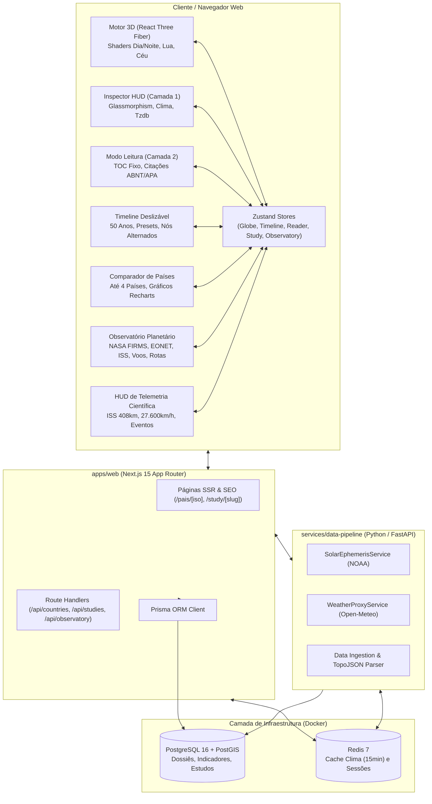
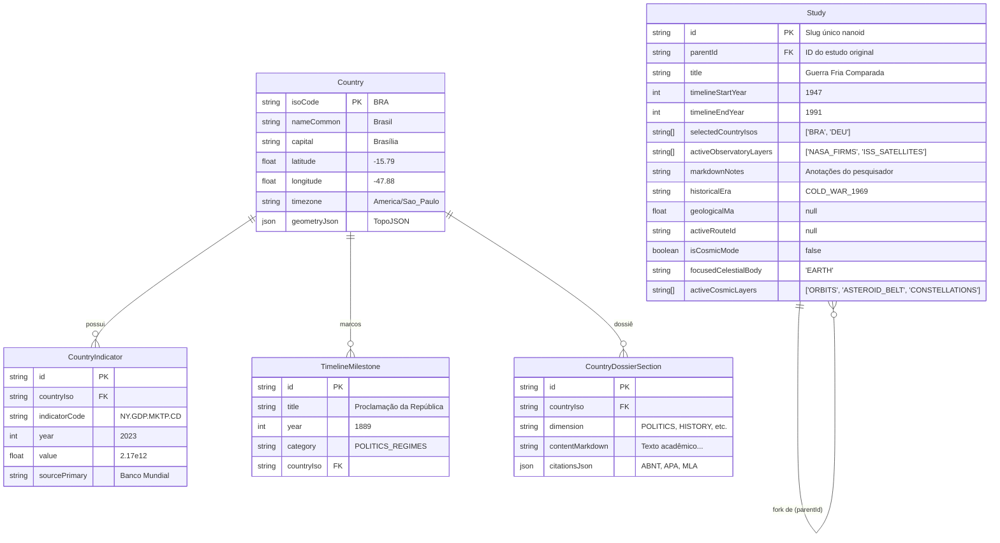

# Arquitetura Técnica — TellusPedia

## 1. Visão Geral da Arquitetura

O **TellusPedia** é concebido sob uma arquitetura de monorepo moderno que equilibra:
- Renderização gráfica 3D pesada em tempo real (WebGL/Three.js a 60 FPS) via **React Three Fiber**.
- Plataforma enciclopédica densa em **Next.js 15 (App Router)** com SSR, rotas semânticas indexáveis para SEO e leitura tipograficamente acadêmica.
- Microsserviço científico em **Python (FastAPI)** com Clean Architecture para efemérides solares NOAA, fases lunares e ingestão de datasets geofísicos.
- Persistência geoespacial com **PostgreSQL 16 + PostGIS**, cache segregado por volatilidade no **Redis 7** e ORM com **Prisma**.



---

## 2. Arquitetura do Frontend (`apps/web`)

### 2.1. Estrutura de Diretórios (Feature-Driven / Layered)
```
apps/web/
├── public/
│   ├── data/
│   │   ├── history/                   # Snapshots TopoJSON (borders-1870, 1914, 1939, 1969)
│   │   └── ne_110m_admin_0_countries.json # TopoJSON contemporâneo (177 países)
│   ├── flags/                         # Bandeiras contemporâneas e históricas em SVG
│   └── textures/                      # Texturas NASA (earth_day, earth_night, moon)
├── prisma/
│   ├── schema.prisma                  # Esquema Prisma (Country, Indicator, Milestone, Study com historicalEra)
│   └── seed.ts                        # Seed de países piloto, TopoJSON e marcos históricos
├── src/
│   ├── app/                           # App Router (Páginas, SEO e Route Handlers)
│   │   ├── layout.tsx                 # Root layout com tipografia Cosmic Academic
│   │   ├── page.tsx                   # Landing Page (Globo + HUD + Timeline)
│   │   ├── compare/page.tsx           # Comparador de até 4 países (/compare)
│   │   ├── pais/[iso]/page.tsx        # Página canônica do país para SEO (/pais/BRA)
│   │   ├── study/[slug]/page.tsx      # Estudo imutável compartilhado (/study/[slug])
│   │   └── api/                       # Endpoints Next.js com suporte a fork, histórico e observatório
│   │       ├── countries/             # Metadados e busca de países
│   │       ├── studies/               # Criação, busca e fork de estudos (/api/studies/[slug]/fork)
│   │       └── observatory/           # Proxies científicos e telemetria (/firms, /eonet, /iss, /traffic, /cosmos)
│   ├── components/
│   │   ├── globe/                     # Motor 3D Three.js / React Three Fiber
│   │   │   ├── GlobeCanvas.tsx        # Canvas, iluminação solar sincronizada e render loop
│   │   │   ├── EarthSphere.tsx        # Esfera da Terra com shader dia/noite e Fresnel
│   │   │   ├── EarthShaderMaterial.ts # Shader GLSL em espaço mundial
│   │   │   ├── CountryBorders.tsx     # Malha vetorial esférica com cross-fade histórico
│   │   │   ├── OrbitingMoon.tsx       # Lua em órbita com fase proporcional e seleção interativa
│   │   │   ├── SkyStars.tsx           # Abóbada celeste HYG com 3.500+ estrelas e 88 constelações IAU
│   │   │   ├── CameraFlyToController.tsx # Animação de câmera suave com interpolação esférica
│   │   │   ├── CosmicCameraController.tsx # Controlador de câmera cósmica e reancoramento de target
│   │   │   ├── SunCore.tsx            # Sol emissivo central com shader GLSL de corona pulsante
│   │   │   ├── PlanetarySystem.tsx    # Malhas planetárias PBR, anéis de Saturno/Urano e órbitas
│   │   │   ├── AsteroidBeltLayer.tsx  # 3.000+ asteroides via THREE.InstancedMesh
│   │   │   ├── CometHalleyTrajectory.tsx # Órbita excêntrica e cauda iônica oposta ao Sol
│   │   │   ├── MeteorShowersLayer.tsx # Chuvas sazonais de meteoros (Perseidas e Geminídeas)
│   │   │   ├── Apollo11Trajectory.tsx # Rota 3D translunar Catmull-Rom e nave animada (CSM/LM)
│   │   │   ├── Apollo11TelemetryOverlay.tsx # HUD de telemetria científica (velocidade, distância, GET)
│   │   │   ├── HistoricalRouteTrajectory.tsx # Traçado 3D geodésico da Nau Victoria com rastro de esteira
│   │   │   ├── HistoricalRouteOverlay.tsx # HUD de telemetria náutica e diário de Pigafetta
│   │   │   ├── PaleoPlatesLayer.tsx   # Placas tectônicas e linhas de fratura da Pangeia (1.002)
│   │   │   ├── PaleoEraBadge.tsx      # Badge flutuante de era geológica com reset para contemporâneo
│   │   │   ├── HistoricalEraBadge.tsx # Badge flutuante de era com reset para contemporâneo
│   │   │   ├── NasaFirmsLayer.tsx     # Focos de queimadas globais via THREE.Points a R=1.0025
│   │   │   ├── NasaEonetLayer.tsx     # Marcadores 3D pulsantes de eventos severos a R=1.006
│   │   │   ├── IssOrbitLayer.tsx      # Malha poligonal 3D e órbita física da ISS a R=1.18
│   │   │   ├── AirTrafficLayer.tsx    # Frota comercial via THREE.InstancedMesh a R=1.018
│   │   │   └── MaritimeRoutesLayer.tsx# Arcos geodésicos marinhos mercantes a R=1.003
│   │   ├── observatory/               # Camada 3: Observatório Planetário & Tráfego Global
│   │   │   ├── ObservatoryPanel.tsx   # Drawer lateral com toggles de camadas e contadores ao vivo
│   │   │   └── ObservatoryTelemetryHUD.tsx # HUD flutuante com telemetria contínua da ISS/voos
│   │   ├── hud/                       # Camada 1: Inspector HUD
│   │   │   ├── InspectorHUD.tsx       # Drawer lateral flutuante em glassmorphism
│   │   │   ├── CosmicInspectorHUD.tsx # Drawer lateral de astrofísica planetária e exploração
│   │   │   ├── CountryHeader.tsx      # Bandeira vetorial, nome oficial e capital
│   │   │   ├── LiveWeatherWidget.tsx  # Clima ao vivo via Open-Meteo
│   │   │   ├── LocalClockWidget.tsx   # Relógio no fuso horário local tzdb
│   │   │   └── CountryMetricsGrid.tsx # Indicadores socioeconômicos rápidos
│   │   ├── reader/                    # Camada 2: Modo Leitura Profunda
│   │   │   ├── ReaderMode.tsx         # Layout imersivo de estudo acadêmico
│   │   │   ├── ReaderTableOfContents.tsx # Sumário fixo navegável (TOC)
│   │   │   ├── ReaderContent.tsx      # Renderização de texto com notas de rodapé
│   │   │   ├── HoverCardPreview.tsx   # Card flutuante para links internos
│   │   │   └── CitationModal.tsx      # Exportador ABNT NBR 6023, APA, MLA, BibTeX
│   │   ├── timeline/                  # Linha do Tempo Dinâmica
│   │   │   ├── TimelineBar.tsx        # Barra horizontal deslizável com controles de velocidade orbital
│   │   │   ├── TimelineAxis.tsx       # Réguas de tempo e escala semântica
│   │   │   ├── MilestonePin.tsx       # Nós alternados acima/abaixo do eixo
│   │   │   ├── CategoryFilterPills.tsx# Filtros por categoria temática
│   │   │   └── PresetSelector.tsx     # Atalhos (Últimos 50 Anos, Guerra Fria, Pangeia, Magalhães)
│   │   ├── comparator/                # Comparador de até 4 Países (RN15)
│   │   │   ├── CountryComparator.tsx  # Painel comparativo
│   │   │   ├── ComparisonGrid.tsx     # Colunas métricas equiparadas
│   │   │   └── ComparisonCharts.tsx   # Gráficos de séries temporais com Recharts
│   │   ├── study/                     # Estudos Compartilháveis & Fork (RN16)
│   │   │   ├── StudyShareModal.tsx    # Modal de criação de link imutável
│   │   │   └── ForkStudyBanner.tsx    # Banner de estudo com botão "Fazer Fork"
│   │   └── nav/                       # Barra de navegação superior com alternador "Sistema Solar"
│   ├── stores/                        # Gerenciamento de Estado Reativo (Zustand)
│   │   ├── globeStore.ts              # Hover, seleção, câmera e render loop throttling
│   │   ├── cosmicStore.ts             # Modo cósmico, alvo focado, camadas e velocidade orbital
│   │   ├── timelineStore.ts           # Anos, marcos, escala geológica (Ma), filtros e presets
│   │   ├── readerStore.ts             # Dimensão ativa e estado de leitura
│   │   ├── comparatorStore.ts         # Países selecionados para comparação
│   │   ├── studyStore.ts              # Recorte de estudo, camadas ativas, modo cósmico e fork
│   │   ├── observatoryStore.ts        # Camadas ativas, opacidades, seleção de telemetria e cache
│   │   ├── apollo11Store.ts           # Telemetria e controles da missão Apollo 11
│   │   └── historicalRouteStore.ts    # Reprodução e waypoints da rota de circum-navegação
│   └── lib/                           # Utilitários, efemérides, datasets e citações
│       ├── astronomy-planets.ts       # Modelo analítico Standish/JPL de órbitas keplerianas
│       ├── hyg-star-data.ts           # Catálogo HYG com 3.500+ estrelas J2000 e 88 constelações IAU
│       ├── historical-entities.ts     # Resolução contínua de entidades históricas
│       ├── historical-topology.ts     # Carregamento e cache assíncrono de TopoJSON
│       ├── historical-routes.ts       # Reconstituição da circum-navegação de Magalhães-Elcano
│       ├── paleo-data.ts              # Catálogo de eras paleogeográficas e placas da Pangeia
│       ├── apollo11.ts                # Física orbital e telemetria da Apollo 11
│       └── observatory-data.ts        # Propagação orbital SGP4 da ISS, tipos e fallbacks
└── test/
    ├── unit.test.ts                   # 180 testes automatizados em 24 suítes cobrindo todas as regras
    └── cosmic.test.ts                 # Testes unitários focados nas efemérides cósmicas Standish
```

### 2.2. Engenharia Gráfica 3D (Shaders e Picking)

#### Shader de Terminador Solar Dia/Noite (`EarthShaderMaterial.ts`)
- O vertex shader calcula a normal em espaço mundial:
  ```glsl
  vNormal = normalize((modelMatrix * vec4(normal, 0.0)).xyz);
  ```
- O fragment shader calcula a incidência da luz solar através do produto escalar com o vetor de luz mundial:
  ```glsl
  float sunDot = dot(normal, uSunDirection);
  float dayFactor = smoothstep(-0.15, 0.25, sunDot);
  vec3 finalColor = mix(nightColor, dayColor, dayFactor);
  ```
- O brilho atmosférico translúcido é gerado via efeito Fresnel:
  ```glsl
  float fresnel = pow(1.0 - max(dot(normal, viewDir), 0.0), 3.0);
  finalColor += uAtmosphereColor * fresnel * 0.6;
  ```

#### Picking Ultrarrápido por Raycast Lat/Long (<0.2ms)
1. O raycaster atinge uma esfera física única de raio unitário ($R=1.0$).
2. A intersecção $(x, y, z)$ é convertida matematicamente em coordenadas geográficas:
   $$\text{lat} = \arcsin(y / R) \cdot \frac{180}{\pi}, \quad \text{lng} = \arctan2(-z, x) \cdot \frac{180}{\pi}$$
3. O ponto $(\text{lng}, \text{lat})$ é consultado em memória no índice espacial montado com `which-polygon` a partir do TopoJSON Natural Earth. O tempo de resposta é inferior a 0.2 milissegundos sem sobrecarregar a GPU com malhas 3D individuais.

#### Render Loop Throttling (RN22)
Quando o usuário expande a Camada 2 (Modo Leitura Profunda), o estado `isReaderOpen` aciona a desaceleração do loop gráfico do Three.js, reduzindo o consumo de energia e ciclos de GPU durante o estudo textual prolongado.

### 2.3. Engenharia do Observatório Planetário & Tráfego Global (Horizonte 3)

O Horizonte 3 introduz uma arquitetura de visualização em tempo quase real de dados científicos e telemetria:
1. **Queimadas Ativas (NASA FIRMS - RN17)**:
   - Renderização em nuvem de pontos via `THREE.Points` a $R = 1.0025$.
   - Buffers `Float32Array` de posição e cor (mapeamento térmico de Fire Radiative Power - FRP) isolados da opacidade para evitar re-alocações desnecessárias na GPU durante a manipulação do painel.
2. **Eventos Naturais Severos (NASA EONET - RN17)**:
   - Marcadores esféricos a $R = 1.006$ com anéis pulsantes e raycast picking para inspeção de ciclones, tempestades tropicais e erupções vulcânicas.
3. **Estação Espacial Internacional (ISS) & Satélites (RN18)**:
   - Malha poligonal 3D da ISS posicionada em altitude LEO realista ($R = 1.18$).
   - Propagação contínua a 60 FPS no `useFrame` via `calculateIssPosition(Date.now())` com orientação dos painéis solares pelo vetor velocidade tangente da órbita (inclinação $51.64^\circ$, altitude 408 km e velocidade $27.600\text{ km/h}$).
   - Traçado de órbita elíptica completa em grande círculo memoizado (`Line`).
4. **Tráfego Aéreo Comercial (OpenSky ADS-B - RN18)**:
   - Renderização via `THREE.InstancedMesh` em altitude de cruzeiro $R = 1.018$ orientando as aeronaves em base ortonormal indexada pelo rumo (*heading*).
5. **Rotas Marítimas Comerciais (AIS - RN18)**:
   - Grandes estreitos (Suez, Panamá, Malaca) e corredores oceânicos traçados em arcos geodésicos esféricos a $R = 1.003$ com interpolação `slerpVectors`.
6. **Supressão Automática de Anacronismos (RN09 & RN10)**:
   - Quando a Linha do Tempo for posicionada antes de 1957 (início da era espacial com o Sputnik) ou em eras geológicas (Pangeia), a função canônica `isContemporaryEpoch` suprime instantaneamente as camadas de satélites e aviação moderna da cena 3D, exibindo banner contextual no `ObservatoryPanel`.

### 2.4. Engenharia da Expansão Cósmica & Sistema Solar 3D (Horizonte 4)

O Horizonte 4 expande a escala da cena do raio planetário terrestre para o espaço interplanetário e estelar:

1. **Efemérides Keplerianas Analíticas Standish (1992)/NASA JPL (`astronomy-planets.ts`)**:
   - Resolução da Equação de Kepler $M = E - e \sin E$ a 60 FPS por iteração de Newton-Raphson com tolerância $\le 10^{-10}$ (máx. 10 iterações).
   - Elementos orbitais com taxas de variação secular por século juliano ($T$) em relação a J2000.0 cobrindo os 8 planetas e Plutão.
   - Cálculo das coordenadas heliocêntricas no plano orbital e rotação para o referencial de cena tridimensional:
     $$x_{\text{orb}} = a (\cos E - e), \quad y_{\text{orb}} = a \sqrt{1 - e^2} \sin E$$
2. **Mapeamento Não-Linear de Escala Didática ($R_{\text{scene}} = 28 \cdot r^{0.55}$)**:
   - Resolve o dilema astrofísico de proporção (onde Netuno está a 30 UA e Mercúrio a 0.38 UA, gerando invisibilidade mútua ou z-fighting).
   - A transformação power-law preserva estritamente a ordem radial dos corpos celestes, mantém a órbita de Netuno contida dentro do frustum distante ($R \approx 180$) e permite transição contínua sem quebras de profundidade geométrica.
3. **Reancoramento Dinâmico de Câmera (`CosmicCameraController.tsx`)**:
   - Handover matemático do vetor `controls.target`: ao focar um corpo celeste (Sol, Mercúrio, Vênus, Terra, Lua, Marte, etc.), interpola simultaneamente `camera.position` e `controls.target` com offsets proporcionais ao raio visual.
   - Limpeza de deltas inerciais residuais no OrbitControls e guarda estrita contra vetores nulos ou divisões por zero, impedindo a injeção de `NaN`.
4. **Sol Emissivo com Corona GLSL e Iluminação PBR (`SunCore.tsx`)**:
   - Shader procedural de corona solar baseado em ruído tridimensional de Simplex pulsante dependente do tempo (`uTime`), com atenuação física e luz pontual central (`pointLight`) que ilumina realisticamente as faces dos planetas.
5. **Cinturão de Asteroides Instanciado (`AsteroidBeltLayer.tsx`)**:
   - Mais de 3.000 asteroides individuais entre 2.2 e 3.2 UA instanciados em uma única chamada de desenho GPU (`THREE.InstancedMesh`), com variações de escala, matrizes de rotação e velocidades angulares keplerianas.
6. **Dinâmica do Cometa 1P/Halley & Chuvas de Meteoros (`CometHalleyTrajectory.tsx`, `MeteorShowersLayer.tsx`)**:
   - Trajetória orbital fechada com excentricidade extrema ($e = 0.967$). Cauda do cometa gerada por malha cônica translúcida orientada estritamente no vetor antipodal ao Sol ($\vec{v}_{\text{tail}} = \text{normalize}(\vec{pos} - \vec{0})$), com luminosidade modulada por $1 / r^2$.
   - Chuvas de meteoros sazonais renderizadas em feixes pontuais convergentes durante as janelas orbitais de interseção com a Terra (Perseidas em Agosto e Geminídeas em Dezembro).
7. **Abóbada Celeste HYG e 88 Constelações IAU (`SkyStars.tsx`, `hyg-star-data.ts`)**:
   - Catálogo estelar HYG com 3.500+ estrelas reais até magnitude aparente $V \le 5.5$.
   - Coordenadas equatoriais J2000 (Ascensão Reta $\alpha$ e Declinação $\delta$) projetadas na esfera celeste de raio $R = 900$:
     $$x = R \cos \delta \cos \alpha, \quad y = R \sin \delta, \quad z = -R \cos \delta \sin \alpha$$
   - Temperatura de cor e cor espectral estimada via índice $B-V$ com mapeamento procedural de matiz RGB.
   - Traçado das 88 constelações oficiais padronizadas pela IAU com asterismos e rótulos tipográficos.
8. **Seleção Interativa Integrada da Terra e da Lua**:
   - Seleção da Terra no Modo Cosmos: suprime a inspeção de países soberanos individuais e abre a ficha técnica planetária no `CosmicInspectorHUD`, com botão "Explorar Superfície / Países" que restaura a visão geopolítica normal.
   - Seleção da Lua: interativa tanto na órbita terrestre normal quanto no Modo Cosmos, calculando dinamicamente `currentMoonWorldPos`, renderizando o anel de destaque e oferecendo botões contextuais de navegação ("Voltar à Terra" / "Focar na Terra").

---

## 3. Arquitetura do Backend (`services/data-pipeline`)

O microsserviço Python em **FastAPI** segue a **Clean Architecture**, segregado em:
1. **Controladores (`app/api/endpoints`)**:
   - `astronomy.py`: Retorna a declinação solar, longitude subsolar e fases da Lua calculadas pelo algoritmo NOAA.
   - `weather.py`: Proxy resiliente para a Open-Meteo API com cache Redis.
2. **Camada de Domínio (`app/domain/models`)**: Modelos Pydantic tipados e imutáveis.
3. **Serviços Científicos (`app/services`)**:
   - `solar_service.py`: Cálculo da posição solar a partir da data e hora UTC.
   - `weather_proxy_service.py`: Cache e circuit breaker para chamadas externas.
4. **Infraestrutura (`app/core`)**: Pool de conexões assíncronas do Redis e PostgreSQL.

---

## 4. Política de Segregação de Cache (RN23)

| Camada de Dados | Fontes | Armazenamento | Política de Cache / TTL |
| :--- | :--- | :--- | :--- |
| **Alta Volatilidade (Tempo Real)** | Posição orbital da ISS (CelesTrak / SGP4). | In-Memory Route Proxy | **60 segundos** com renovação automática. |
| **Alta Volatilidade (Tráfego)** | Tráfego Aéreo (OpenSky ADS-B) e Rotas AIS. | In-Memory Route Proxy | **120 segundos** com deduplicação de requisições. |
| **Média-Alta Volatilidade (Satélite)** | Queimadas (NASA FIRMS) e Eventos Severos (NASA EONET). | In-Memory Route Proxy / Redis | **15 minutos** com fallbacks integrados. |
| **Média-Alta Volatilidade (Cosmos / JPL)** | Efemérides de alta precisão NASA JPL Horizons (`/api/observatory/cosmos`). | In-Memory Route Proxy (SWR) | **1 hora** com fallback para modelo analítico Standish. |
| **Média-Alta Volatilidade (Clima)** | Clima ao vivo (Open-Meteo), efemérides solares NOAA. | Redis 7 | **15 minutos** com circuit breaker. |
| **Média Volatilidade** | Indicadores socioeconômicos anuais (Banco Mundial, IBGE), notícias GDELT. | PostgreSQL + Redis | **24 horas a 7 dias**; atualizados por jobs em lote. |
| **Imutável** | Polígonos de fronteiras (TopoJSON), eras paleogeográficas, marcos consolidados, estudos compartilhados. | PostgreSQL 16 (PostGIS) | **Permanente**. Headers `Cache-Control: public, max-age=31536000, immutable`. |

---

## 5. Modelo de Dados e Estudos Imutáveis com Fork (RN16)


