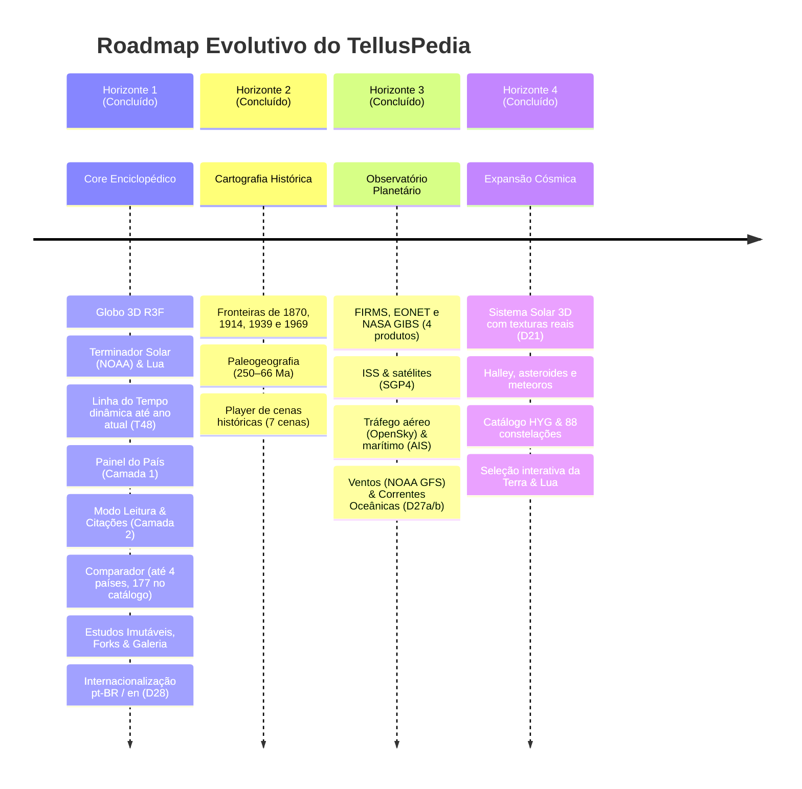

# Roadmap de Engenharia — TellusPedia

O TellusPedia evoluiu em **4 Horizontes** de produto, seguidos de ciclos de correção, diferenciação científica e expansão enciclopédica coordenados pelo [`BACKLOG.md`](BACKLOG.md). Este documento resume **o que existe hoje** e **o que está planejado no Ciclo 3**; o status operacional de cada tarefa (`TODO`, `IN_PROGRESS`, `REVIEW`, `DONE`) é sempre o do backlog.

> Última sincronização com o código: 2026-11-23 (T42 — pós-conclusão dos Ciclos 1 e 2 + `T48`).

---

## 1. O que existe hoje (Ciclos 1 e 2 concluídos)

### Horizonte 1 — Core enciclopédico, globo, i18n e estudos
- **Globo 3D**: shader dia/noite com normais em espaço mundial, direção solar única por efemérides NOAA (T14), Lua com posição astronômica real (T15), oceanos, relevo, nuvens e atmosfera (D02), fronteiras com espessura real e highlight em cache (D03, T16), picking por raycast lat/long (<0,2 ms) e qualidade gráfica adaptativa DPR/FPS (`Auto`/`Alto`/`Médio`/`Baixo`, T39).
- **Linha do tempo**: janela padrão dinâmica de 50 anos até o ano atual (`CURRENT_YEAR`, hoje `1976–2026`, com marcos curados até 2026 — T48), eixo com zoom, clusters e prévias (D13), filtros por categoria, presets humanos/geológicos/expedição e seletor único de época `useEpochState` (T12).
- **Internacionalização (`pt-BR` ↔ `en`, D28a/D28b)**: dicionários sob demanda sem inflar `/` (`< 160 kB`), `Intl` + `Intl.DisplayNames` para os 177 países, persistência em `localStorage` + cookie `telluspedia_locale`, metadados SSR localizados, tradução integral da casca, painéis profundos, `/studies`, `/telluslab`, os 14 dossiês (`/dossies/[slug]`) e telas de erro.
- **Painel do país (Camada 1)**: ficha padronizada, relógio local (tzdb), clima ao vivo (Open-Meteo) e indicadores reais do Banco Mundial para os 177 países (T26, T32) no design system D14.
- **Modo Leitura (Camada 2)**: dossiê multidisciplinar com sumário, notas de rodapé e citações ABNT NBR 6023, APA 7, MLA 9 e BibTeX; modo analítico para todos os 177 países (ranking global, comparação regional, T38).
- **Comparador**: até 4 países entre os 177, séries históricas reais 1990–2024 sem dados fabricados (T29, T32).
- **Mapa temático coroplético**: 177 países coloridos por indicador real, com legenda e escala (D22).
- **Estudos**: links `/study/[slug]` imutáveis com fork rastreável (`parentId`), galeria pública `/studies`, exportação ABNT/APA (D23) e persistência de camadas, era, cena, modo cósmico, mapa temático, GIBS e ventos/correntes.
- **TellusBridge**: cobertura curricular ≥ 85% dos 299 nós do TellusLab, 14 dossiês/figuras e painel `/telluslab` com importação de snapshot JSON (D26).
- **Busca universal ⌘K e estado na URL** (D18), layout de painéis (D15), movimento e transições (D17), responsividade e contraste (D19), acessibilidade (T22).

### Horizonte 2 — Cartografia histórica, paleogeografia e cenas
- **Fronteiras históricas**: TopoJSON de 1870, 1914, 1939 e 1969 com cross-fade; entidades `PRU`, `SUN`, `AHU`, `GDR`, `FRG`, `TUR_HIST`, `YUG`, `CSK` com bandeira, governantes e dossiê.
- **Paleogeografia (RN11)**: Pangeia (~250 Ma), fragmentação (~200 Ma), Gondwana & Laurásia (~150 Ma) e K-Pg (~66 Ma), com paleomapas PALEOMAP, placas tectônicas e supressão das luzes urbanas.
- **Player de cenas dirigido por dados (D12, D24)**: cenas sob demanda em `src/data/scenes/` — Apollo 11 (1969), Magalhães–Elcano (1519–1522), Marco Polo (1271), Vasco da Gama (1497), 1914, 1939 e queda do Muro de Berlim (1989).

### Horizonte 3 — Observatório planetário e tráfego global
- **NASA FIRMS**: focos ativos com sprites, heatmap e resumo por país (D05).
- **NASA EONET**: eventos severos com símbolos, clusters e trilhas (D06).
- **NASA GIBS**: 4 produtos mensais (NDVI, neve, gelo marinho, temperatura da superfície) servidos pelo próprio TellusPedia (D25).
- **Ventos globais e correntes oceânicas (D27a/D27b)**: partículas GPU animadas sobre o globo com campos NOAA GFS (10 m / jato 250 hPa) e correntes oceânicas superficiais (Open-Meteo Marine / Copernicus–NOAA), com seletor `Ventos | Correntes | Ambos` e legenda em km/h e nós.
- **ISS e satélites**: SGP4 sobre TLEs do CelesTrak com `satellite.js` sob demanda (D04, T35).
- **Tráfego aéreo e marítimo**: OpenSky Network (ADS-B com modelos glTF, D07) e amostra AIS Stream em seis corredores (D08).
- **Procedência explícita** em toda camada (`live`, `cache`, `stale` ou `fallback`, T05).

### Horizonte 4 — Expansão cósmica
- **Sistema Solar** com efemérides keplerianas Standish (1992)/JPL, escala visual e real (D11), texturas planetárias reais (KTX2 + JPG), inclinação axial, rotação sideral e sombras nos anéis de Saturno (D21).
- **Halley** com núcleo esculpido, coma e cauda dupla na distância real (D10); cinturão de asteroides instanciado; chuvas de meteoros sazonais; catálogo HYG v4.1 e as 88 constelações IAU (D09).

### Qualidade, segurança e produção
- Design system D14 com tokens, primitivos e regressão automática (D14, D20).
- CI (Web + Playwright E2E + Python `uv` + PostgreSQL/PostGIS migrations & seed), cabeçalhos de segurança e `Cache-Control` (T30), Error Boundaries e fallback sem GPU (T31), SEO técnico e PWA manifest (T33), empacotamento standalone com `/api/health` e Redis no rate-limit (T34), ESLint flat config e `prisma.config.ts` (T42).
- Bundle inicial de `/` mantido abaixo de 160 kB gzip (T25, T35) e arquivos mantidos abaixo de 600 linhas (T36).

---

## 2. Planejado — Ciclo 3 (detalhamento em [`BACKLOG.md`](BACKLOG.md))

| Frente | Fases / Tarefas |
|---|---|
| Blindagem, rate-limit nas 12 APIs, E2E do Ciclo 2, modularização T36, PWA offline, observabilidade e LoD `1:50m` | Fase 12 (`T42`–`T49`) |
| Observatório ambiental: **Lixo marítimo & microplásticos** (acoplado a D27), **INPE BDQueimadas + TerraBrasilis**, **Mapa dos Biomas** e **Mapa de Espécies Animais (GBIF/IUCN)** | Fase 13 (`D29`–`D32`) |
| **Modo 2D & projeções cartográficas** (`Equal Earth`, `Mercator`, `Natural Earth`, `Azimutal`), **Coroplético temporal 1990–2024** (`CO₂` e `Renovável %`) e **Perfis editoriais** (G20 + Lusofonia + América Latina) | Fase 14 (`D33`–`D35`) |
| **Geografia Crítica & Milton Santos** (dossiê, centenário 1926–2026, lentes espaciais e *Os Quatro Brasis*), **Estúdio de pesquisa** (régua geodésica, CSV/PNG, pinos) e **Timeline transversal + GDELT** | Fase 15 (`D36`–`D38`) |
| **Sismologia/tectônica (USGS + PB2002)**, **Cabos submarinos + Qualidade do ar** e **Eclipses + Sondas (Voyager/JWST/New Horizons)** | Fase 16 (`D39`–`D41`) |
| **i18n profundo** (cenas/crônicas/pilotos), **Cartografia histórica 1500 & 1815** e **TellusBridge v2 (100% dos 299 nós)** | Fase 17 (`D42`–`D44`) |
