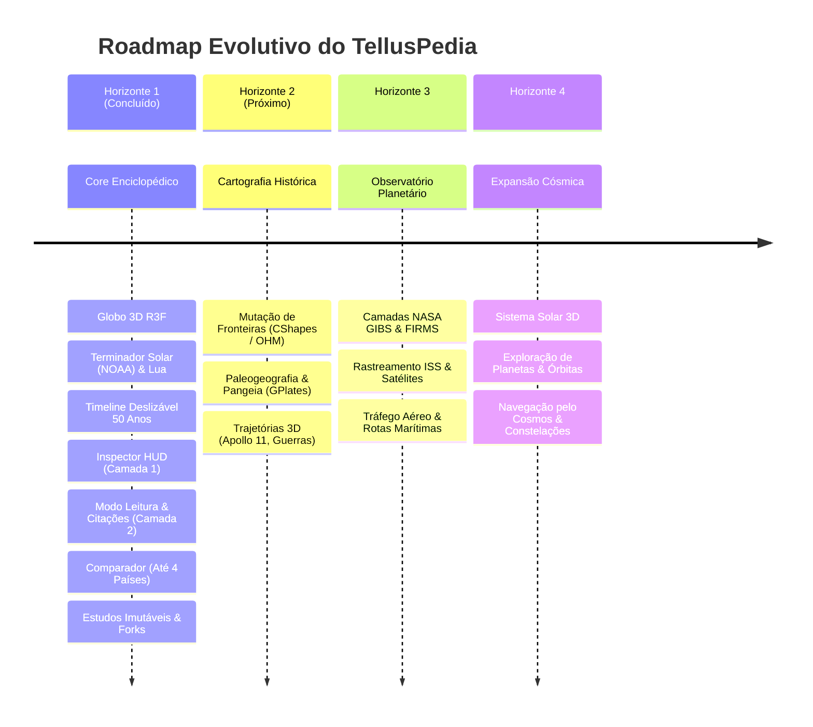

# Roadmap de Engenharia — TellusPedia

Todas as funcionalidades do TellusPedia são organizadas em **4 Horizontes Evolutivos** para assegurar excelência técnica, performance e rigor científico.

---

## Detalhamento dos Horizontes

### Horizonte 1 — Core Enciclopédico, Globo Base & Estudos *(Status: Concluído)*
- **Globo 3D Base**: Renderização com shader solar dia/noite calculado por efemérides NOAA, Lua em órbita, constelações IAU por data e fronteiras TopoJSON com picking instantâneo (<0.2ms).
- **Linha do Tempo (50 Anos Padrão)**: Barra horizontal deslizável com nós alternados acima e abaixo do eixo, filtros temáticos (Política, Economia, Guerra, Ciência & Cultura, Saúde) e sincronização bidirecional com a luz solar e a câmera do globo.
- **Camada 1 (Inspector HUD)**: Ficha técnica padronizada, relógio do fuso horário local (tzdb) e clima ao vivo via Open-Meteo em gaveta glassmorphism.
- **Camada 2 (Modo Leitura Profunda)**: Dossiê multidisciplinar completo com sumário fixo navegável, notas de rodapé, hover preview de verbetes e gerador de citações formatadas em **ABNT NBR 6023**, **APA 7**, **MLA 9** e **BibTeX (.bib)**.
- **Comparador Configurável (Até 4 Países)**: Destaque visual quádruplo no globo, colunas equiparadas e gráficos de séries temporais com Recharts.
- **Estudos Imutáveis e Forks Compartilháveis (RN16)**: Links `/study/[slug]` permanentes no PostgreSQL com suporte nativo a bifurcações rastreáveis (`parentId`).

---

### Horizonte 2 — Cartografia Histórica, Paleogeografia e Trajetórias 3D *(Status: Fase 1 Concluída | Fechamento Planejado)*
- **Cartografia Histórica Dinâmica (Concluído)**:
  - Snapshots TopoJSON para **1870** (Unificação Alemã / Guerra Franco-Prussiana), **1914** (Primeira Guerra Mundial), **1939** (Segunda Guerra Mundial) e **1969** (Guerra Fria) com interpolação de opacidade (*cross-fade*) e descarte de geometria no Three.js.
  - Catálogo e resolução contínua de entidades históricas (`PRU`, `SUN`, `AHU`, `GDR`, `FRG`, `TUR_HIST`, `YUG`, `CSK`) com bandeiras SVG autênticas, indicadores, governantes e continuidade territorial bidirecional (`resolveHistoricalEntity`).
  - Raycast picking instantâneo (<0.2ms) adaptado à malha da era histórica ativa.
  - Badge flutuante contextual (`HistoricalEraBadge`) com proteção contra colisões de layout.
- **Trajetórias Físicas 3D — Missões Espaciais (Concluído)**:
  - Visualização translunar 3D completa da **Apollo 11 (1969)** com curva Catmull-Rom da Terra até o Mar da Tranquilidade na Lua.
  - Modelo animado (CSM Columbia / LM Eagle) percorrendo a rota, folga orbital garantida sem colisão lunar ($\ge 0.270$) e HUD de telemetria científica (distância, velocidade e GET).
- **Persistência de Estudos Históricos com Fork (Concluído)**:
  - Serialização imutável dos campos `historicalEra` e `isApollo11Active` em Prisma, endpoints de fork (`/api/studies/[slug]/fork`) e Zustand stores.
- **Fechamento do Horizonte 2 (Planejado / Em Execução)**:
  - *Paleogeografia & Deriva Continental (RN11)*: Escala geológica em Milhões de Anos (Ma) com conformação continental da **Pangeia (~250 Ma)**, fragmentação (~200 Ma), **Gondwana & Laurásia (~150 Ma)** e Cretáceo K-Pg (~66 Ma) via blend no shader (`uPaleoTexture`, `uPaleoFactor`) e supressão física de luzes elétricas urbanas.
  - *Trajetórias Marítimas 3D (RN12)*: Reconstituição geodésica 3D da **Primeira Circum-navegação da Terra por Fernão de Magalhães e Juan Sebastián Elcano (1519–1522)** com a *Nau Victoria* animada e diário de bordo com telemetria naval histórica.

---

### Horizonte 3 — Observatório Planetário (NASA) & Tráfego Global
- **Camadas Científicas da NASA**:
  - **NASA GIBS**: Mais de 1.000 camadas de imagens de satélite atualizadas diariamente (neve/gelo, relevo, cobertura vegetal).
  - **NASA FIRMS & INPE BDQueimadas**: Monitoramento global de focos ativos de queimadas em tempo quase real.
  - **NASA EONET**: Rastreamento de eventos severos (tempestades, vulcões, secas).
  - **Fluxos de Ventos e Lixo Marítimo**: Visualização de correntes oceânicas e microplásticos.
- **Telemetria de Tráfego Global e Órbita**:
  - Rastreamento em tempo real da **Estação Espacial Internacional (ISS)** e satélites artificiais via **CelesTrak (TLE)**.
  - Camada de aeronaves sobrevoando o globo via **OpenSky Network (ADS-B)**.
  - Principais rotas marítimas comerciais via dados agregados de AIS (**Global Fishing Watch**).

---

### Horizonte 4 — Expansão Cósmica
- **Navegação além da Órbita Terrestre**: Zoom contínuo expandindo para a visualização do **Sistema Solar**.
- **Modelagem de Corpos Celestes**: Planetas, luas, asteroides, cometas e meteoros com efemérides de alta precisão do **NASA JPL Horizons API** e **Minor Planet Center (MPC)**.
