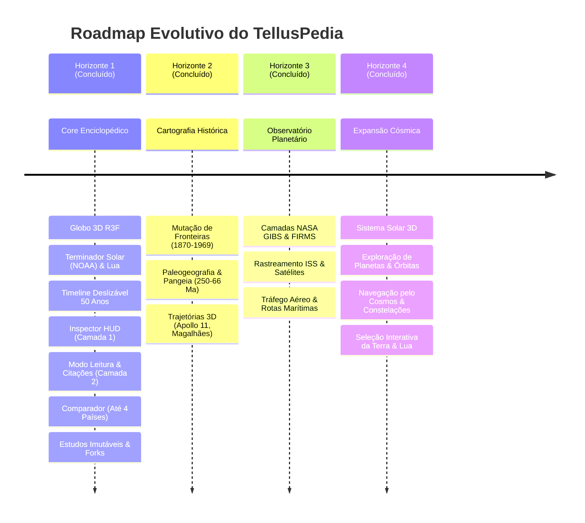

# Roadmap de Engenharia — TellusPedia

Todas as funcionalidades do TellusPedia são organizadas em **4 Horizontes Evolutivos** para assegurar excelência técnica, performance e rigor científico.

---

## Detalhamento dos Horizontes

### Horizonte 1 — Core Enciclopédico, Globo Base & Estudos *(Status: Concluído)*
- **Globo 3D Base**: Renderização com shader solar dia/noite calculado por efemérides NOAA, Lua em órbita, constelações IAU por data e fronteiras TopoJSON com picking instantâneo (<0.2ms).
- **Linha do Tempo (50 Anos Padrão)**: Barra horizontal deslizável com nós alternados acima e abaixo do eixo, filtros temáticos (Política, Economia, Guerra, Ciência & Cultura, Saúde) e sincronização bidirecional com a luz solar e a câmera do globo.
- **Camada 1 (Inspector HUD)**: Ficha técnica padronizada, relógio do fuso horário local (tzdb) e clima ao vivo via Open-Meteo em gaveta glassmorphism.
- **Camada 2 (Modo Leitura Profunda)**: Dossiê multidisciplinar completo com sumário fixo navegável, notas de rodapé, hover preview de verbetes e gerador de citações formatadas em **ABNT NBR 6023**, **APA 7**, **MLA 9** e **BibTeX (.bib)**.
- **Comparador Configurável (Até 4 Países)**: Destaque visual quádruplo no globo, colunas equiparadas e gráficos de séries temporais com Recharts.
- **Estudos Imutáveis e Forks Compartilháveis (RN16)**: Links `/study/[slug]` permanentes no PostgreSQL com suporte nativo a bifurcações rastreáveis (`parentId`).

---

### Horizonte 2 — Cartografia Histórica, Paleogeografia e Trajetórias 3D *(Status: Concluído)*
- **Cartografia Histórica Dinâmica (Concluído)**:
  - Snapshots TopoJSON para **1870** (Unificação Alemã / Guerra Franco-Prussiana), **1914** (Primeira Guerra Mundial), **1939** (Segunda Guerra Mundial) e **1969** (Guerra Fria) com interpolação de opacidade (*cross-fade*) e descarte de geometria no Three.js.
  - Catálogo e resolução contínua de entidades históricas (`PRU`, `SUN`, `AHU`, `GDR`, `FRG`, `TUR_HIST`, `YUG`, `CSK`) com bandeiras SVG autênticas, indicadores, governantes e continuidade territorial bidirecional (`resolveHistoricalEntity`).
  - Raycast picking instantâneo (<0.2ms) adaptado à malha da era histórica ativa.
  - Badge flutuante contextual (`HistoricalEraBadge`) com proteção contra colisões de layout.
- **Paleogeografia & Deriva Continental (RN11) (Concluído)**:
  - Escala geológica em Milhões de Anos (Ma) cobrindo **Pangeia (~250 Ma)**, fragmentação inicial (~200 Ma), **Gondwana & Laurásia (~150 Ma)** e **Cretáceo K-Pg (~66 Ma)**.
  - Shader `EarthShaderMaterial.ts` com uniforms `uPaleoTexture` e `uPaleoFactor` com interpolação contínua e **supressão física automática de luzes elétricas urbanas** (`cityLightFactor -> 0`).
  - Camada de placas tectônicas e linhas de fratura paleogeográficas (`PaleoPlatesLayer.tsx`) na altitude $1.002$.
  - Badge de era geológica (`PaleoEraBadge.tsx`) com retorno imediato à contemporaneidade.
- **Trajetórias Físicas 3D (RN12) (Concluído)**:
  - *Missão Apollo 11 (1969)*: Rota translunar 3D Catmull-Rom da Terra ao Mar da Tranquilidade na Lua com nave animada (CSM/LM), folga orbital estrita ($\ge 0.270$) e HUD de telemetria científica (distância, velocidade e GET).
  - *Circum-navegação de Magalhães-Elcano (1519–1522)*: Traçado geodésico esférico no raio $1.004$ com a *Nau Victoria* animada em base ortonormal, rastro de esteira (*wake effect*), waypoints geográficos e HUD de telemetria náutica com extratos do diário de Antonio Pigafetta.
- **Persistência de Estudos com Fork Histórico e Geológico (RN16) (Concluído)**:
  - Serialização imutável dos campos `historicalEra`, `isApollo11Active`, `geologicalMa` e `activeRouteId` em Prisma, endpoints de fork (`/api/studies/[slug]/fork`), modal de compartilhamento e Zustand stores.

---

### Horizonte 3 — Observatório Planetário (NASA) & Tráfego Global *(Status: Concluído)*
- **Camadas Científicas da NASA**:
  - **NASA GIBS**: Mais de 1.000 camadas de imagens de satélite atualizadas diariamente (neve/gelo, relevo, cobertura vegetal).
  - **NASA FIRMS & INPE BDQueimadas**: Monitoramento global de focos ativos de queimadas em tempo quase real.
  - **NASA EONET**: Rastreamento de eventos severos (tempestades, vulcões, secas).
  - **Fluxos de Ventos e Lixo Marítimo**: Visualização de correntes oceânicas e microplásticos.
- **Telemetria de Tráfego Global e Órbita**:
  - Rastreamento em tempo real da **Estação Espacial Internacional (ISS)** e satélites artificiais via **CelesTrak (TLE)**.
  - Camada de aeronaves sobrevoando o globo via **OpenSky Network (ADS-B)**.
  - Principais rotas marítimas comerciais via dados agregados de AIS (**Global Fishing Watch**).

---

### Horizonte 4 — Expansão Cósmica *(Status: Concluído)*
- **Sistema Solar 3D & Efemérides Keplerianas (RN18, RN20) (Concluído)**:
  - Resolução analítica em tempo real da Equação de Kepler com algoritmo de Newton-Raphson e convergência $< 10^{-10}$ a 60 FPS no loop gráfico, cobrindo todos os 8 planetas do Sistema Solar + Plutão via formulação Standish (1992)/NASA JPL (`apps/web/src/lib/astronomy-planets.ts`).
  - Mapeamento de escala didática balanceada ($R_{\text{scene}} = 28 \cdot r^{0.55}$) garantindo preservação de ordem, visualização contínua das órbitas internas e externas e supressão de z-fighting no frustum da câmera.
  - Sol emissivo central (`SunCore.tsx`) com shader GLSL customizado de corona pulsante e `pointLight` com atenuação física.
  - Planetas com texturas PBR, anéis translúcidos de Saturno e Urano e curvas orbitais fechadas (`generateOrbitalPathPoints`) em `PlanetarySystem.tsx`.
  - Desduplicação da Terra no modo cósmico (`id !== "EARTH"`), preservando a malha fotorrealista com shader dia/noite e Fresnel de `EarthSphere.tsx`.
- **Cinturão de Asteroides, Cometa Halley e Meteoros (RN18, RN20) (Concluído)**:
  - Mais de 3.000 asteroides do cinturão principal entre Marte e Júpiter renderizados via `THREE.InstancedMesh` com matrizes de rotação e tamanhos heterogêneos (`AsteroidBeltLayer.tsx`).
  - Dinâmica orbital de alta excentricidade ($e = 0.967$) do Cometa 1P/Halley com cauda iônica/poeira orientada radialmente em oposição ao vetor solar e intensidade luminosa inversamente proporcional ao quadrado da distância ao Sol (`CometHalleyTrajectory.tsx`).
  - Chuvas sazonais de meteoros (Perseidas em Agosto e Geminídeas em Dezembro) renderizadas em feixes pontuais convergentes (`MeteorShowersLayer.tsx`).
- **Abóbada Celeste HYG & 88 Constelações IAU (RN19) (Concluído)**:
  - Catálogo estelar HYG com 3.500+ estrelas ($V \le 5.5$) em coordenadas equatoriais J2000 convertidas em coordenadas esféricas tridimensionais no raio $R = 900$ (`hyg-star-data.ts`).
  - Índice de cor $B-V$ mapeado proceduralmente para classes espectrais reais (azuis $O/B$ a avermelhadas $M$).
  - Malha vetorial dos 88 asterismos e constelações oficiais da União Astronômica Internacional (IAU) com rótulos tipográficos na abóbada celeste (`SkyStars.tsx`).
- **HUD de Inspeção Cósmica & Controles de Reprodução (RN03, RN10) (Concluído)**:
  - Painel lateral em glassmorphism (`CosmicInspectorHUD.tsx`) com ficha técnica astrofísica padronizada (raio, massa, gravidade, período orbital, temperatura média, atmosfera), cálculo dinâmico de distâncias Terra/Sol em UA e km, fases lunares via `getLunarPhase`, missões espaciais históricas e referências acadêmicas com links diretos (NASA/JPL/IAU).
  - Controles de reprodução e velocidade orbital na `TimelineBar.tsx` ($1\times, 30\times, 365\times$) acoplados à store reativa `useCosmicStore`.
  - Botão de acesso rápido "Sistema Solar / Cosmos" na barra superior (`TopNavBar.tsx`).
- **Seleção Interativa da Terra e da Lua (Concluído)**:
  - Seleção da Terra no modo cosmos: suprime seleção de países, foca a Terra com ficha planetária e botão contextual "Explorar Superfície / Países".
  - Seleção da Lua no modo normal e no modo cósmico: cálculo e sincronização contínua de `currentMoonWorldPos`, anel luminoso de seleção, HUD com fase lunar e botões contextuais "Voltar à Terra" / "Focar na Terra".
  - Transição e reancoramento suave de `controls.target` via `CosmicCameraController.tsx` entre o centro da Terra `(0, 0, 0)`, a Lua e qualquer planeta sem causar `NaN` no `OrbitControls`.
- **Persistência de Estudos Cósmicos com Fork Imutável (RN16) (Concluído)**:
  - Extensão do esquema Prisma `Study` e `useStudyStore` com os campos `isCosmicMode`, `focusedCelestialBody` e `activeCosmicLayers`, garantindo integridade nos endpoints de fork e modal de compartilhamento (`StudyShareModal.tsx`).
