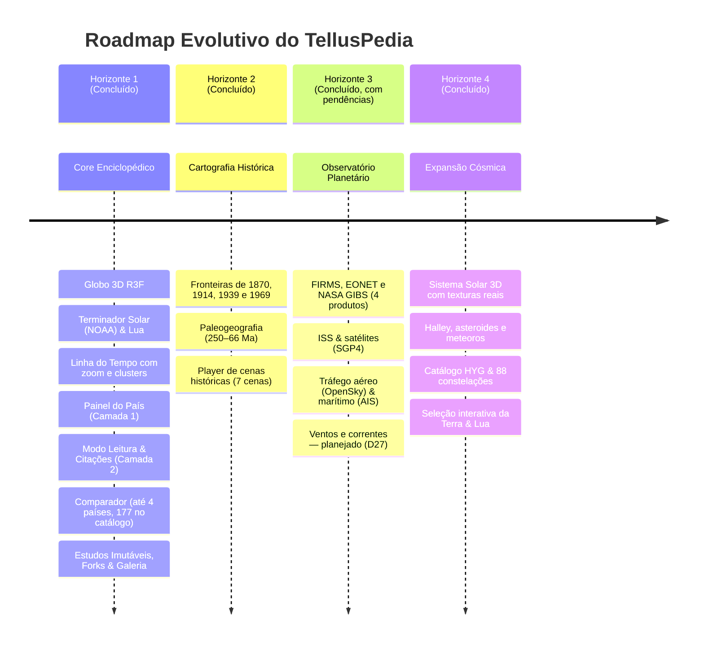

# Roadmap de Engenharia — TellusPedia

O TellusPedia evoluiu em **4 Horizontes** de produto, seguidos de dois ciclos de correção e diferenciação coordenados pelo [`BACKLOG.md`](BACKLOG.md). Este documento resume **o que existe hoje** e **o que ainda está planejado**; o estado de cada tarefa (TODO, IN_PROGRESS, REVIEW, DONE) é sempre o do backlog.

> Última sincronização com o código: 2026-11-21 (T37).

---

## 1. O que existe hoje

### Horizonte 1 — Core enciclopédico, globo e estudos
- **Globo 3D**: shader dia/noite com normais em espaço mundial, direção solar única por efemérides NOAA (T14), Lua com posição astronômica real (T15), oceanos, relevo, nuvens e atmosfera (D02), fronteiras com espessura real e highlight em cache (D03, T16), picking por raycast lat/long (<0,2 ms).
- **Linha do tempo**: eixo com zoom, clusters e prévias (D13), filtros por categoria, presets (50 anos, Século XXI, Guerra Fria, Guerras Mundiais, eras geológicas, Magalhães) e seletor único de época `useEpochState` (T12).
- **Painel do país (Camada 1)**: ficha padronizada, relógio local (tzdb), clima ao vivo (Open-Meteo) e indicadores reais do Banco Mundial para os 177 países (T26, T32) — no painel do design system D14 (a antiga gaveta glassmorphism foi substituída).
- **Modo Leitura (Camada 2)**: dossiê multidisciplinar com sumário, notas de rodapé e citações ABNT NBR 6023, APA 7, MLA 9 e BibTeX; modo analítico para os 177 países (ranking global, comparação regional, T38).
- **Comparador**: até 4 países entre os 177, séries históricas reais 1990–2024 sem dados fabricados (T29, T32).
- **Mapa temático coroplético**: 177 países coloridos por indicador real, com legenda e escala (D22).
- **Estudos**: links `/study/[slug]` imutáveis com fork rastreável (`parentId`), galeria pública `/studies`, exportação ABNT/APA (D23) e persistência de camadas, era, cena, modo cósmico, mapa temático e camada GIBS.
- **Busca universal ⌘K e estado na URL** (D18), layout de painéis (D15), movimento e transições (D17), responsividade e contraste (D19), acessibilidade (T22).

### Horizonte 2 — Cartografia histórica, paleogeografia e cenas
- **Fronteiras históricas**: TopoJSON de 1870, 1914, 1939 e 1969 com cross-fade; entidades `PRU`, `SUN`, `AHU`, `GDR`, `FRG`, `TUR_HIST`, `YUG`, `CSK` com bandeira, governantes e dossiê.
- **Paleogeografia (RN11)**: Pangeia (~250 Ma), fragmentação (~200 Ma), Gondwana & Laurásia (~150 Ma) e K-Pg (~66 Ma), com paleomapas PALEOMAP, placas tectônicas e supressão das luzes urbanas.
- **Player de cenas dirigido por dados (D12, D24)**: cenas em `src/data/scenes/` com trajetória de superfície ou cislunar, painel genérico e crônica — Apollo 11 (1969), Magalhães–Elcano (1519–1522), Marco Polo (1271), Vasco da Gama (1497), 1914, 1939 e queda do Muro de Berlim (1989). As cenas grandes carregam sob demanda.

### Horizonte 3 — Observatório planetário e tráfego global
- **NASA FIRMS**: focos ativos com sprites, heatmap e resumo por país (D05).
- **NASA EONET**: eventos severos com símbolos, clusters e trilhas (D06).
- **NASA GIBS**: 4 produtos mensais (NDVI, neve, gelo marinho, temperatura da superfície) com mês, legenda e opacidade, servidos pelo próprio TellusPedia (D25).
- **ISS e satélites**: SGP4 sobre TLEs do CelesTrak, órbita e rastro (D04); o `satellite.js` só carrega com a camada ligada (T35).
- **Tráfego aéreo**: OpenSky Network (ADS-B) com modelos glTF e interpolação (D07).
- **Tráfego marítimo**: amostra AIS (AIS Stream) em seis corredores e malha fixa de rotas de referência (D08).
- **Procedência explícita** em toda camada: ao vivo, calculado ou simulado (T05), com dados locais de referência quando a fonte cai.

### Horizonte 4 — Expansão cósmica
- **Sistema Solar** com efemérides keplerianas Standish (1992)/JPL, escala visual e real (D11), texturas planetárias reais, inclinação axial, rotação sideral e sombras nos anéis de Saturno (D21).
- **Halley** com núcleo esculpido, coma e cauda dupla na distância real (D10); cinturão de asteroides instanciado; chuvas de meteoros sazonais.
- **Céu**: catálogo HYG v4.1 até magnitude 6,5 e as 88 constelações (D09).
- **Seleção da Terra e da Lua** no modo Cosmos, com reancoramento seguro da câmera.

### Qualidade, segurança e produção (Ciclos 1 e 2)
- Design system com tokens e primitivos (D14, D20) e regressão automática.
- CI, testes de API e E2E visual (T18, T19), migrations Prisma (T20).
- Cabeçalhos de segurança e `Cache-Control` (T30), Error Boundaries e fallback sem GPU (T31), SEO técnico e PWA (T33), empacotamento standalone com `/api/health` e Redis no rate-limit (T34).
- Bundle inicial de `/` em 158,8 kB gzip (T25, T35) e arquivos acima de 600 linhas divididos (T36).

---

## 2. Planejado / em andamento

| Item | Tarefa | Situação em 2026-11-21 |
|---|---|---|
| Ventos globais e correntes oceânicas (partículas GPU, GFS/NOAA) | D27 | TODO |
| Internacionalização `pt-BR` / `en` | D28 | TODO |
| Qualidade gráfica adaptativa (DPR dinâmico, presets) | T39 | Em andamento |
| Aviso de hidratação no botão Observatório em `/study/<id>` | T41 | TODO |
| Lixo marítimo e microplásticos | — | Sem tarefa no backlog (citado em versões antigas deste roadmap, não implementado) |
| INPE BDQueimadas | — | Sem tarefa no backlog (o Observatório usa só o NASA FIRMS) |
